# 🔍 Data Quality Monitoring Platform

An end-to-end Data Quality and Analytics Engineering project built with **dbt**, **DuckDB**, **Python**, **Streamlit**, and **Plotly**.

The project simulates an e-commerce environment, implements data transformations using dbt, applies automated data quality checks, and provides an interactive monitoring dashboard for investigating data issues.

---

# 🚀 Tech Stack

- Python
- Pandas
- Faker
- DuckDB
- dbt Core
- Streamlit
- Plotly

---

# 📊 Project Architecture

```text
CSV Seeds
    ↓
Staging Layer
    ↓
Intermediate Layer
    ↓
Mart Layer
    ↓
Data Quality Tests
    ↓
Streamlit Dashboard
```

---

# 📁 Project Structure

```text
dbt-analytics-project
│
├── analyses/
├── dashboards/
│   └── dashboard.py
│
├── models/
│   ├── staging/
│   ├── intermediate/
│   └── marts/
│
├── seeds/
│   ├── customers.csv
│   ├── products.csv
│   ├── orders.csv
│   ├── order_items.csv
│   └── payments.csv
│
├── tests/
├── dbt_project.yml
├── profiles.yml
├── generate_data.py
└── README.md
```

---

# 📦 Generated Data

| Dataset | Records |
|----------|---------:|
| Customers | 10,000 |
| Products | 1,000 |
| Orders | 100,000 |
| Order Items | 300,000 |
| Payments | 100,000 |

---

# 🏗️ dbt Models

## Staging Layer

- stg_customers
- stg_products
- stg_orders
- stg_order_items
- stg_payments

## Intermediate Layer

- int_customer_orders
- int_product_sales

## Mart Layer

- dim_customers
- dim_products
- fct_orders
- fct_sales

---

# ✅ Data Quality Controls

Implemented automated data quality validation using dbt.

### Standard Tests

- not_null
- unique
- accepted_values

### Custom Tests

- payment_amount_positive

---

# 🚨 Simulated Data Quality Issues

The project intentionally introduces data quality problems for testing purposes.

| Issue | Count |
|---------|--------:|
| Missing Emails | 50 |
| Duplicate Emails | 210 |
| Invalid Order Statuses | 20 |
| Negative Payments | 100 |

---

# 📈 Dashboard Features

## Business Analytics

- Revenue by Category
- Top Products by Revenue
- Top Countries by Customer Base

## Data Quality Monitoring

- Data Quality Score
- KPI Metrics
- Failed Test Summary
- Payment Outlier Detection
- Payment Distribution Analysis
- Data Quality Findings

## Investigation Center

- Missing Email Records
- Duplicate Email Investigation
- Invalid Order Status Investigation
- Negative Payment Investigation

---

# 📚 Documentation

Generate dbt documentation:

```bash
dbt docs generate --profiles-dir .
```

Run documentation server:

```bash
dbt docs serve --profiles-dir .
```

---

# ▶️ Running the Dashboard

```bash
streamlit run dashboards/dashboard.py
```

---

# 🎯 Project Goals

- Build a layered dbt architecture
- Implement automated data quality checks
- Detect and investigate data anomalies
- Create a monitoring dashboard for business and data quality stakeholders
- Demonstrate Analytics Engineering and Data Quality Engineering skills

---

# 📸 Screenshots

## dbt Lineage Graph

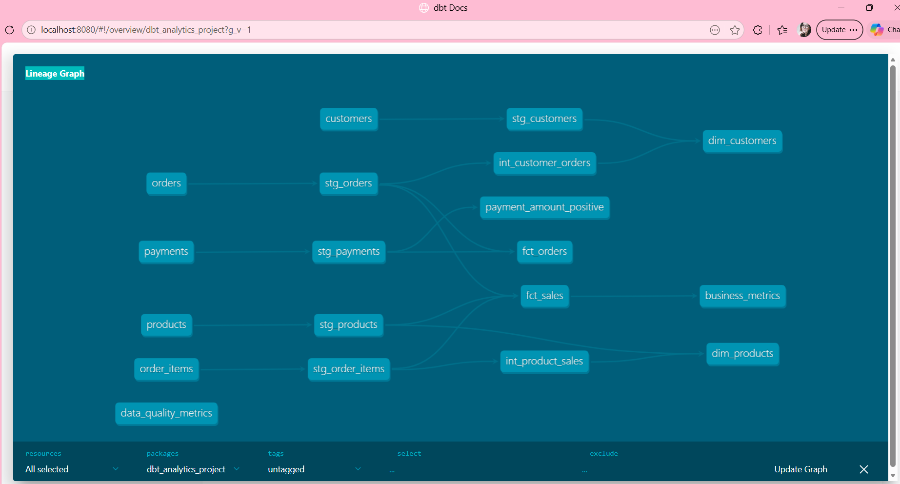

## Businnes Analytics
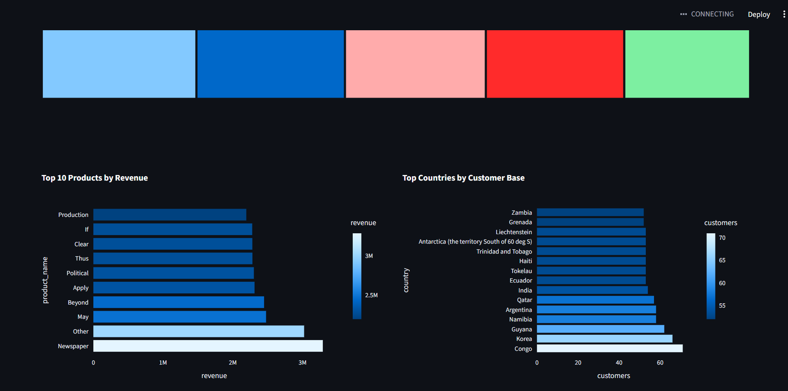
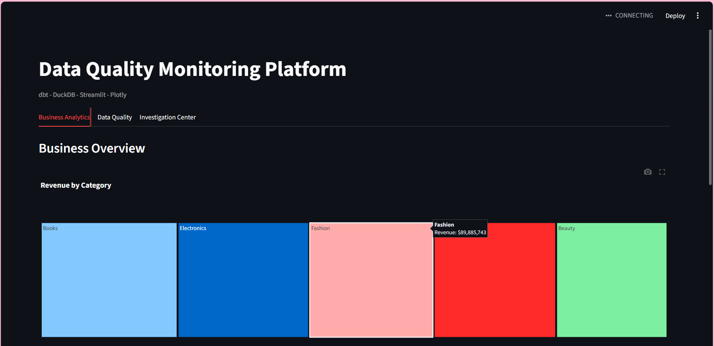


## Data Quality Dashboard

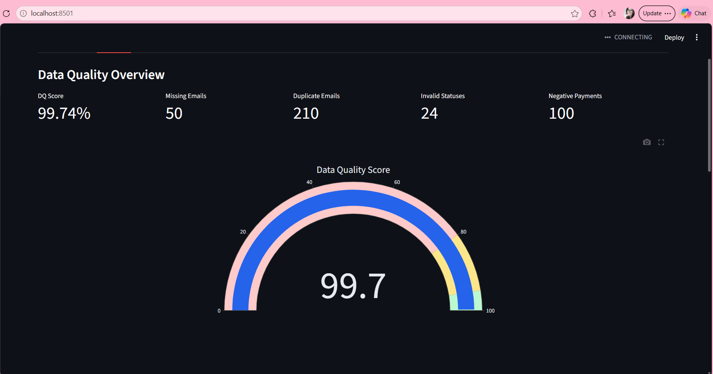
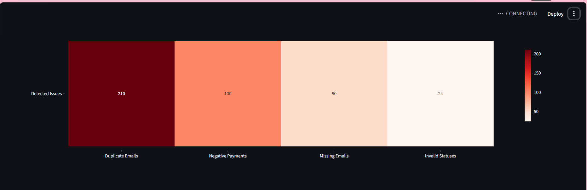
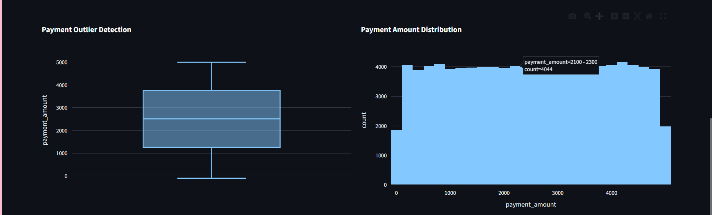
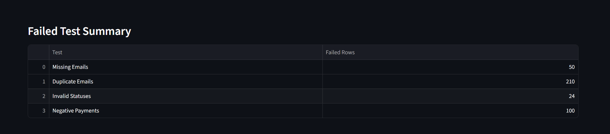
## Investigation Center

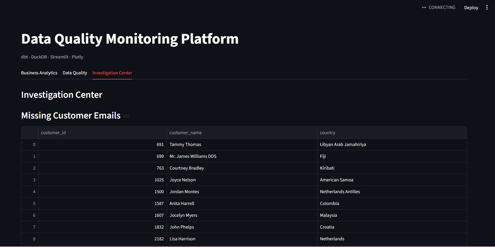
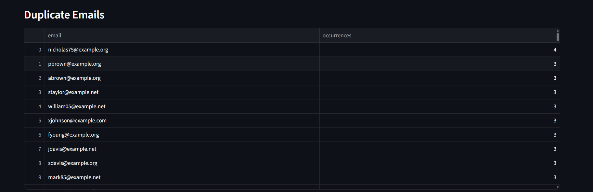
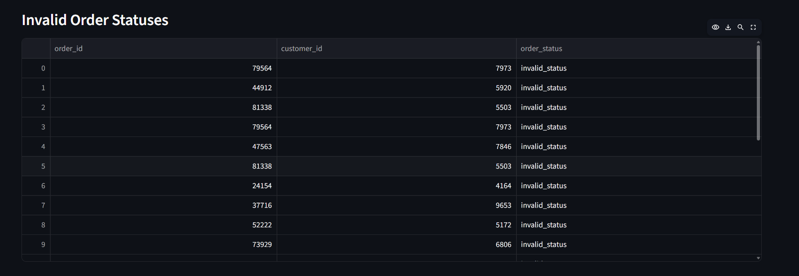
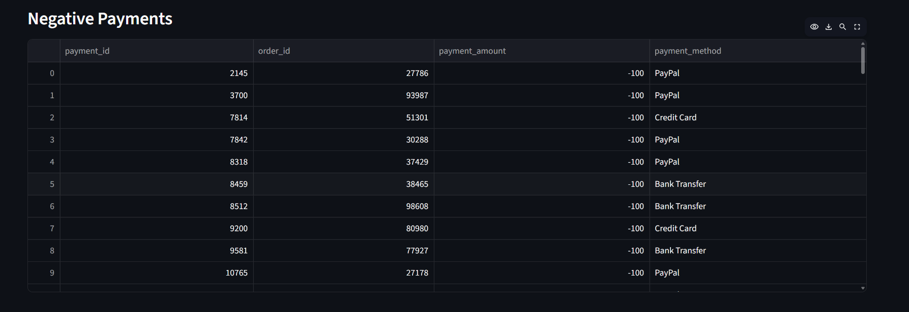

---

# 👤 Author

Anna Tereshchuk

